# kindle-dash

The Pi renders `curl wttr.in` to a 1072x1448 grayscale PNG and pushes it to a jailbroken
Kindle Paperwhite over the USB cable. The Kindle's Wi-Fi stays off.

```
render.py        fetch wttr.in -> out/weather.png   (all settings in its CONFIG block)
push.sh          ping Kindle -> scp image -> ssh "eips -c; eips -g"   (exits 0 if unplugged)
setup_usbnet.sh  finds the Kindle's USB interface, PRINTS the nmcli command (changes nothing)
dashboard.service / dashboard.timer   run render.py + push.sh every REFRESH_MINUTES
```

| | |
|---|---|
| 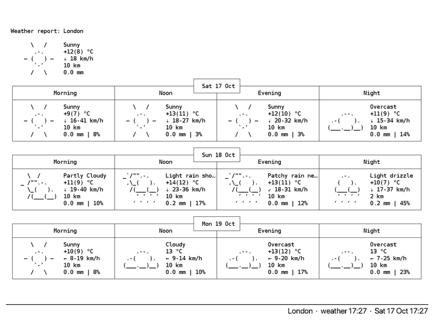 | 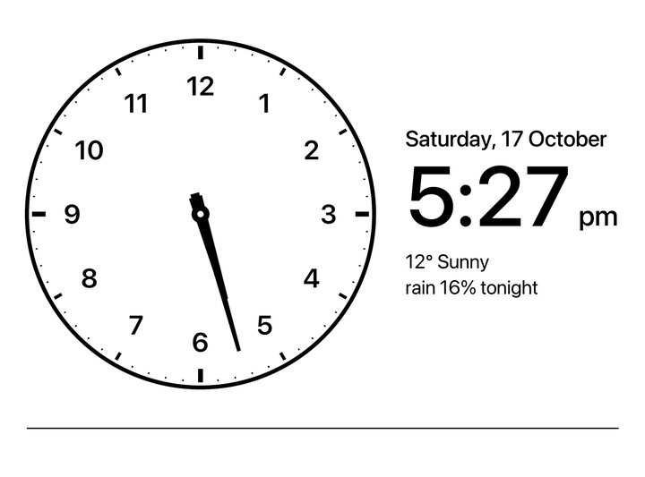 |
| 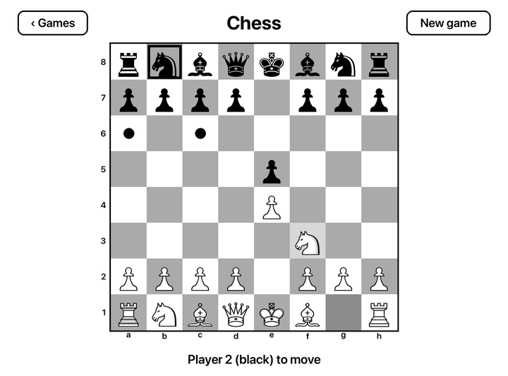 | 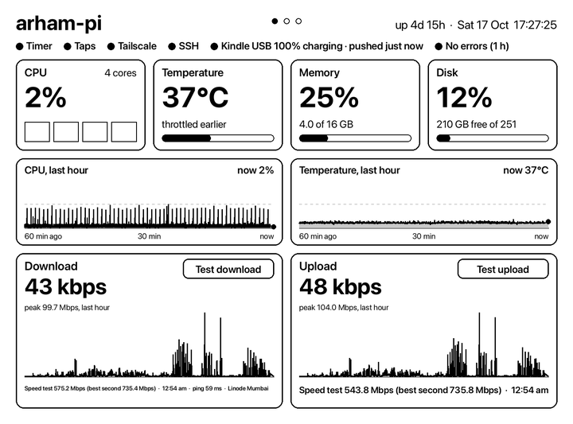 |
| 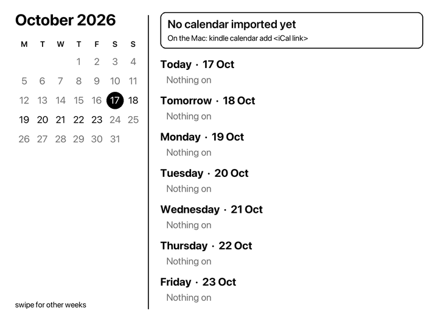 | 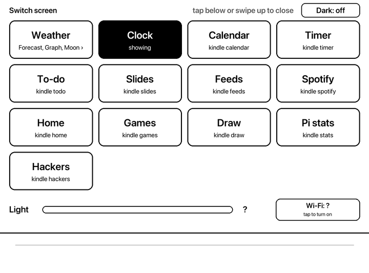 |

<sub>Real renders at half size (made by `mac/sim/screenshots.py`; Pi stats is a live grab from the Pi).
To try them with the mouse, see [Kindle Sim](#kindle-sim-test-on-the-mac).</sub>

## Home (the default screen)

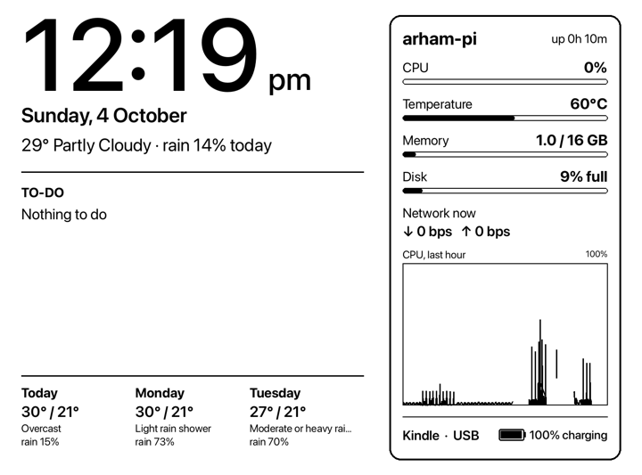

`kindle home` (or Home in the menu): a big clock, the date and today's weather, what's coming up
(next calendar event or reminder, a running timer), your to-dos and a 3-day forecast on the left;
the Pi on the right (CPU, temperature, memory, disk, uptime, network right now, a CPU graph of the
last hour with gaps where there were no readings, any throttling warning) and the Kindle's battery
and link. Redrawn every minute (a full flash only every `CLOCK_FULL_REFRESH_EVERY` minutes). Tap
the clock, weather, to-dos or the Pi card to open that screen. It's where the Kindle goes back to
when a picture or message with `--minutes` expires.

## Show your own image or text (from the Mac)

One-time setup on the Mac:
```sh
mkdir -p ~/bin && cp ~/Documents/"kindle tool"/kindle-dash/mac/kindle ~/bin/ && chmod +x ~/bin/kindle
echo 'export PATH="$HOME/bin:$PATH"' >> ~/.zshrc && source ~/.zshrc
```

| Command | What it shows |
|---|---|
| `kindle photo.jpg` | Any image (jpg, png, heic, gif, webp…), fitted and dithered to 16 grays |
| `kindle notes.txt` | A text file, as large as fits |
| `kindle "Back at 5pm"` | A message, as large as fits |
| `pbpaste \| kindle -` | Whatever is on your clipboard |
| `kindle "In a meeting" --minutes 45` | Shows it, then goes back to the weather after 45 minutes |
| `kindle wttr` (or `weather`) | Back to the weather now (classic 3-day table) |
| `kindle wttr2` (or `weather2`) | Weather in wttr.in's v2 view (`?format=v2`: temperature graph, rain, wind, moon). Stays until `kindle wttr` |
| `kindle wttrmoon` (or `weathermoon`) | Moon phase from `wttr.in/moon` |
| `kindle status` | What's showing |

Without `--minutes`, your image or text stays until `kindle weather`. The timer keeps
re-sending it (every 30 minutes, since it doesn't change). On the Pi it's
`~/kindle-dash/venv/bin/python ~/kindle-dash/show.py …` with the same arguments.
Images use the same orientation as the weather (`ROTATE`).

## Clock, xkcd, light, battery

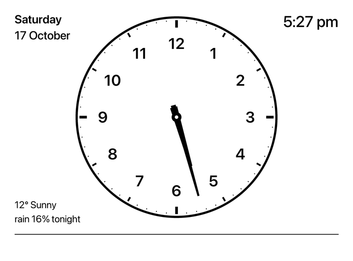

| Command | What it does |
|---|---|
| `kindle clock [analog\|digital\|both]` | An analogue clock face beside the digital time (or just one of them), the date, a one-line forecast ("26° Cloudy · rain 14% tonight") and your next reminder. Tap the clock to switch style. Updates every minute (partial refresh, a full one every 30; double-tap for one now) |
| `kindle brightness 40%` | Front light (also `off`, `max`, `up`, `down`; `kindle brightness` shows it). The menu has a **Light** slider too: tap along the bar |
| `kindle status` | What's showing, plus the Kindle's battery, light and when it was last seen |

The battery appears bottom-right on the weather, clock and to-do screens. It's read on every
push (and every 5 minutes otherwise).

**Mac notifications** (battery ≤ 20% and not charging, Kindle unseen for 10+ minutes, Pi
unreachable). Each one notifies once when it starts and once when it's fixed:
```sh
cp ~/Documents/"kindle tool"/kindle-dash/mac/kindle-watch ~/bin/
cp ~/Documents/"kindle tool"/kindle-dash/mac/com.arham.kindle-watch.plist ~/Library/LaunchAgents/
launchctl load ~/Library/LaunchAgents/com.arham.kindle-watch.plist     # checks every 5 min
```
Stop it with `launchctl unload ~/Library/LaunchAgents/com.arham.kindle-watch.plist`.

**What redraws each minute:** only the screen that's showing, and only if it changes over
time (the weather views, the clock, a feed when it has new items). Photos, text, slides
and the to-do list aren't redrawn, and nothing is redrawn while a reminder or the menu is
up. The timer fires at the start of each minute so the clock is on time.

## Timer and dark mode

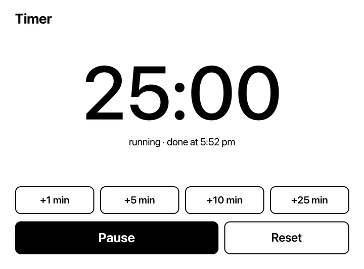

**Timer** (menu → Timer, or `kindle timer`): a big countdown with **+1 / +5 / +10 / +25 min**,
**Start / Pause** and **Reset** buttons on the Kindle. While it runs, only the digits are
redrawn each second. At zero the Kindle flashes and shows "Time's up!" (from any screen; tap to
dismiss). From the Mac: `kindle timer 25m` (also `90s`, `1h30m`, `1:30`, `10` = minutes),
`kindle timer pause | resume | reset | add 5m`.

**Dark mode** (menu → "Dark" button at the top, or `kindle dark on|off`): every screen is
drawn white-on-black: weather, clock, calendar, to-do, feeds, games, timer, menu, drawing. Photos
and slides stay normal (inverted photos look like negatives), and so does Spotify's album
art; screen mirroring and videos are unaffected.

**Double-tap anywhere** to redraw the screen with one clean flash (clears ghosting). On the
clock, a single tap still switches its style, just a moment later (it waits to see if it's a
double tap). The clock does a full flash only every 30 minutes (`CLOCK_FULL_REFRESH_EVERY` in
`render.py`, light or dark), since its digits barely ghost.

E-ink ghosts more in dark mode (the old white-on-black edges linger), so it cleans the screen
more often: a full flash every 3rd minute update instead of every 10th, every 5th tap (games,
menu, buttons) flashes clean, and the timer digits / Pi stats get a clean pass every 12 seconds
instead of 30. Tune with `DARK_FULL_REFRESH_EVERY`, `DARK_QUICK_FULL_EVERY` and
`DARK_CLEAN_EVERY` in `render.py`.

## Games, Spotify, drawing

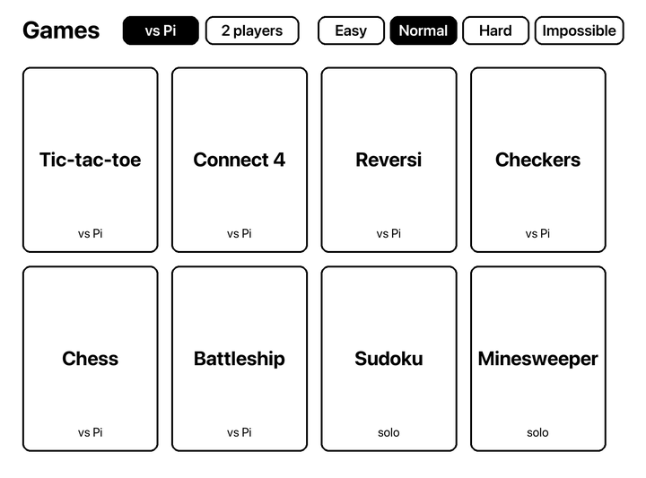 

**Games** (`kindle games`, or the menu). On the picker choose **vs Pi / 2 players** and
**Easy / Normal / Hard**, then tap a game:

| Game | Modes | Notes |
|---|---|---|
| Tic-tac-toe, Connect 4, Reversi | vs Pi, 2 players | Reversi shows dots where you can move |
**Levels** (vs Pi): Easy, Normal and Hard make deliberate mistakes. **Impossible** never does:
tic-tac-toe plays perfectly (a draw is the best you can get); Connect 4, Reversi and Checkers search
as deep as they can in 2.5 s (Connect 4 on a bitboard engine, Reversi solving the ending exactly);
Battleship fires where ships are likeliest, from only what it has seen; chess is **Stockfish**
(built on the Pi in `engines/`, 1.5 s a move). Sudoku's Impossible has 22 clues.

| Checkers | vs Pi, 2 players | tap a piece, then where it goes (each landing square for multi-jumps); captures are compulsory; kings get a ring |
| Chess | vs Pi, 2 players | tap a piece to see its moves (dots, rings for captures), then tap a square; castling, en passant, auto-queen; check, mate, stalemate and the usual draws. Against the Pi your colour is at the bottom; colours swap each game |
| Battleship | vs Pi, 2 players | place your ships: tap one to pick it up (it turns black), tap a square to move it there, **Rotate** to turn it (**Shuffle** = random). 2 players: each picks a 4-digit **PIN**; after your shot tap **Done**, hand over the Kindle, and only the right PIN shows the next player's view |
| Sudoku | solo | a **daily puzzle** per difficulty; tap a square, then a number; **Check** marks mistakes; **New game** = a random puzzle |
| Minesweeper | solo | first tap is always safe; Flag button |

In 2-player games player 1 is black and who starts alternates. The Pi is never perfect: at
every level it sometimes plays a weaker move on purpose (tune `LEVELS` in `games.py`).
Tap the board after a game for a rematch (Battleship/Sudoku: New game).
From the Mac: `kindle games chess`, `kindle games checkers 2p`, `kindle games battleship`, `kindle games sudoku hard`.

**Spotify** (`kindle spotify`): album art, track, artist, progress, and big ⏮ ⏯ ⏭ and
volume −/+ buttons. One-time setup from the Mac: `kindle spotify setup` (it walks you through
creating a free app at developer.spotify.com and catches the login in your browser). Also
`kindle spotify play|pause|next|prev|volume 40`. Controls need **Spotify Premium**; the
now-playing view works on any account. While it's on screen, the progress bar and time tick
**every second** on the Pi's own clock (last position from Spotify + time since), and only
that strip of the screen is sent and refreshed (FBInk's fast DU mode; a clean GC16 every 30
updates). Spotify itself is asked only every 10 seconds (to catch changes made on your
phone/Mac), right after each button, and when a song should have ended. A new song,
play/pause or volume change redraws the whole screen. Tunables in `spotify.py`:
`POLL_SECONDS`, `PROGRESS_TICK`.

**Drawing pad** (`kindle draw`): draw with a finger; each stroke appears when you lift it.
Toolbar: Thin, Thick, Eraser, Undo, Clear, Save. `kindle draw save` copies the drawing to
`~/Pictures/Kindle Drawings/` on the Mac and opens it. On this screen only the very top edge
opens the menu, so you can draw near the top.

## DOOM

`kindle doom` runs DOOM on the Kindle. It's only started this way (it isn't in the menu or the
games list). The game runs on the Pi
([doomgeneric](https://github.com/ozkl/doomgeneric) with a small backend,
`doom/doomgeneric_kindle.c`), and frames go to the Kindle over one ssh connection, brightened and
dithered for e-ink: about 10 frames a second over USB in black/white. Touch buttons around the
picture are the controls, held down like keys. The panel is multi-touch, so you can walk and fire
at once.

| Command | |
|---|---|
| `kindle doom` | Start (the first time it builds the game on the Pi, about 2 minutes) |
| `kindle doom gray` | 16 greys: clearer, but slower |
| `kindle doom stop` | Quit (or tap **Quit DOOM** on the Kindle); the dashboard comes back |
| `kindle doom wad ~/Downloads/doom1.wad` | Use your own game data (shareware `doom1.wad`, or `doom.wad`/`doom2.wad` if you own DOOM) |
| `kindle doom wads` / `kindle doom freedoom2` | List the game data / play a specific one |

It comes with **Freedoom** (free, BSD-licensed DOOM-compatible levels and art). If you add
`doom1.wad` or `doom.wad`, that's used by default. Controls: weapons 1–7 down the left; Menu
(Esc), Enter, Yes, Map and Quit down the right; the D-pad, strafe, Use and FIRE along the bottom.
Start a game with Menu → New Game, then Enter three times. While it runs the dashboard is paused,
like for mirroring. CPU: the game uses about 5% and the frame pipeline about 25% of one core. Picture
brightness is `GAMMA` in `doom.py` (lower = brighter).

## Synth

`kindle synth` turns the Kindle into an instrument and plays the sound on the Mac. Four pages, with
**▶ Play**, **● Rec** and the tempo (− BPM +) always along the top:

- **Keys**: two octaves (multi-touch chords), waveform (Sine/Square/Saw/Triangle), octave, Ring
  short/long, Echo.
- **Drums**: 8 big pads: kick, snare, clap, hat, open hat, low/high tom, crash (all made by the
  synth, no samples).
- **Beat**: the drum pattern, 8 sounds × 16 or 32 steps. Tap squares on and off.
- **Notes**: the note pattern as a piano roll, and the note editor: tap a note to pick it, then
  ▲▼ (pitch, you hear the new note), ◀▶ (move), Longer/Shorter, Delete; tap an empty square to add
  a note; View ↑↓ scrolls the pitches; Undo (50 steps back) and Clear.

Play loops the pattern; **● Rec** (it starts Play too) puts what you play on Keys and Drums into it,
snapped to the nearest step, so a wrong note is two taps to fix on the Notes page. The beat is
timed on the Mac's audio clock (within ~5 ms), so e-ink and the network never make it wobble; a
marker above the grids shows the current beat. Your pattern is saved on the Pi (`out/synth.json`)
and comes back next time. Exit or Ctrl+C ends it. `kindle synth test` is a sound check.

The Pi side is `synth.py` (pages, touches, the pattern); the sound is `mac/synth.py` (24 voices,
smooth envelopes, a soft filter on Square/Saw, echo, soft limiting so nothing crackles), run with the
Kindle Sim's Python (`kindle sim` sets it up; it uses the `sounddevice` package).

## osu!

**Play the real osu!mania with the Kindle as its keys:** `kindle osu pad` (or `pad 7` for 7K). The
Kindle shows big lanes; a finger on a lane holds that key on the Mac (4K: **D F J K**, osu!'s defaults;
5K D F Space J K, 6K S D F J K L, 7K S D F Space J K L), so hold notes and chords work. Open osu!
first (the keys go to the app in front). The first time, macOS asks for **Accessibility** permission
for your Terminal (System Settings → Privacy & Security → Accessibility). Stop on the Kindle or Ctrl+C
ends it and releases every key. A touch takes a few hundredths of a second to reach the Mac; tune it
with osu!'s own offset if needed.

**osu!'s picture shows on the Kindle too**: the Mac grabs osu!'s window about 15 times a second,
finds the mania columns by watching where notes move (so window size and skin don't matter), and
sends just the columns, stretched so each one lines up with the lane you touch, in black and white.
It shows about 7–10 frames a second and runs ~0.2 s behind the Mac (e-ink), so slower maps read
best; `--no-screen` for keys only. It uses the Kindle Sim's Python (`kindle sim` sets it up) and
Screen Recording permission for your Terminal.

The rest of this section is the built-in, simplified game that runs on the Kindle itself:

`kindle osu` plays osu! on the Kindle, a simplified version for e-ink. It's only started from the
Mac (it isn't in the menu or the games list). The Pi runs the game and draws it like DOOM; **the song
plays on the Mac** (the Kindle has no speaker), started at the same moment.

| Command | |
|---|---|
| `kindle osu` | Pick one of your songs (or the demo if you have none) |
| `kindle osu add ~/Downloads/song.osz` | Add beatmaps (`.osz` files from osu.ppy.sh); kept in `~/Library/Application Support/kindle-osu` |
| `kindle osu "song name" [difficulty]` | Play a song (any part of its name); the easiest difficulty unless you name one |
| `kindle osu mania "song" [difficulty]` | **osu!mania**: falling notes in lanes. Plays the song's mania difficulty if it has one, else turns a standard one into 4 lanes (`--keys=N` for more) |
| `kindle osu demo` | A built-in metronome map with a generated click track |
| `kindle osu list` / `folder` | Your songs and difficulties / open the folder |
| `kindle osu offset 40` | Timing: + if circles come early compared to the music, − if late |

Tap circles as their rings close in: 300/100/50/miss, score, combo and accuracy along the top, a
grade at the end. **Quit** (top right) or Ctrl+C on the Mac stops it; the dashboard comes back.
Touches are read straight from the Kindle with its own timestamps, so a tap counts when you tapped.

Simplified for e-ink: circles appear at least 1.2 s ahead (`MIN_PREEMPT`), the timing windows are
1.5x wider (`LENIENCY`), a slider is a tap on its start (its path is drawn), and during a spinner
any taps count. Easy and Normal difficulties work best. Settings are at the top of `osu.py`.

**osu!mania:** tap anywhere in a lane as its note reaches the line near the bottom; hold notes
(hollow bars) are held until their end (letting go early is a miss). Each finger is tracked, so
chords work. Notes take `MANIA_SCROLL_MS` (1.3 s) to fall. Converted maps put each note in a lane by
its position, like osu!'s own conversions.

The library came from osu!lazer on this Mac: 21 Toby Fox beatmap sets (MEGALOVANIA, BIG SHOT, Spider
Dance, Hopes and Dreams...), read from lazer's file store and its database (a copy; lazer's own files
weren't changed) and packed as `.osz` files with just the maps and the song. Taiko and Catch
difficulties don't show up (Battle Against a True Hero is Taiko only).

## Weather map

Menu → Weather → **Map** (or `kindle weathermap`): your state or the whole country with a dot
where you are, showing **Rain**, **Clouds**, **Wind** (arrows: where it blows, longer = stronger) or
**Temperature**. The **slider** at the bottom goes from 6 hours ago to 24 hours ahead: tap a point
on it, use ◀ ▶, or swipe the map sideways to step through the hours and watch weather move.
**Play** steps through the hours by itself (one every 1.2 s, round from 6 h ago to 24 h ahead) so you
can watch the rain or wind move; tap **Stop** to stop. It stops by itself after 3 rounds or
when you leave the map, then does one clean refresh.

It updates itself while it's showing: the "now" mark moves on each hour and new forecast data is
fetched every hour (the models behind it update every 1–6 hours, and each fetch counts 300 points
toward Open-Meteo's free daily limit). Your place is `LOCATION` in `render.py`.

Data: [Open-Meteo](https://open-meteo.com) (free, no key), a 20×15 grid over the view. Borders:
[Natural Earth](https://www.naturalearthdata.com) (public domain), using the country's own point-of-view
country outline; downloaded once, cut down to your country and kept in `maps/`. From the Mac:
`kindle weathermap [rain|clouds|wind|temp] [state|country] [now]`.

## Mandelbrot set

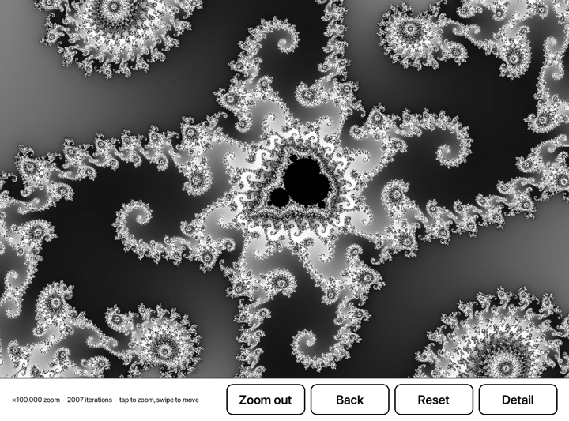

`kindle mandelbrot` (or `kindle fractal`) opens a Mandelbrot set viewer. Like DOOM, it's only
started from the Mac. **Tap** the picture to zoom in 3x around that point; **swipe** to move it
(drag the picture). Buttons: **Zoom out**, **Back** (undo the last move), **Reset** and
**Detail** (2.5x the iterations: sharper edges deep down, a bit slower). It adds detail
automatically as you zoom, and goes down to about 10^11x zoom; past that, 64-bit numbers run
out of precision.

The maths is in `fractal/mandel.c`, compiled the first time and run on all 4 cores: about
0.3 s per screen even deep down (numpy took ~4.5 s). If it can't be compiled, numpy is used.
It only renders when you move, never on the every-minute update. Also from the Mac:
`kindle mandelbrot reset|out|back|detail`.

## Video (e.g. Bad Apple)

| Command | What it does |
|---|---|
| `kindle badapple` | Plays `~/Documents/bad apple/badapple.mp4` |
| `kindle video ~/Movies/clip.mp4` | Plays any video |
| `kindle video stop` | Stops it (or tap the Kindle, or press Ctrl+C on the Mac) |

The first time, the Mac uploads the video, the Pi turns it into 10 fps black-and-white
frames (about 25 s), and copies them to the Kindle (`/mnt/us/dashboard/video/`, about 11 MB
for Bad Apple). Later plays start straight away. The Kindle shows frames with FBInk's fast
A2 mode and skips frames to stay in time, so expect roughly 4–8 fps of real e-ink motion.
**Sound plays on the Mac** (the Kindle has no speaker), starting with the first frame;
`KINDLE_NO_SOUND=1 kindle badapple` for silence. The dashboard pauses while it plays and
comes back afterwards. Needs kiosk mode on, otherwise the Kindle UI may draw over it.

## Pi stats


`kindle stats`, or the menu's **Pi stats** button: a cleaner take on btop: big cards for CPU
(with a bar per core), temperature (and any throttling or under-voltage), memory and disk;
one-hour CPU and temperature graphs; whether the dashboard timer, tap listener, Tailscale and
SSH are running, the Kindle's link and battery, and errors from the last hour (a status row at
the top); and separate Download and Upload panels with live speed and a one-hour graph each. Readings are taken every second in the background (on any
screen), so the graphs show the last hour as soon as you open it. While it's showing it redraws
every second with FBInk's fast greyscale refresh (a clean one now and then); services, errors and
throttling are re-checked every 10 s. Tunables at the top of `health.py`.

**Processes**: swipe left or right on Pi stats for a process list (PID, command, CPU %, memory,
user; kernel threads left out), with **CPU / Memory / Name / PID** sort buttons at the top. CPU %
is per core like `top` (a busy multi-threaded process can pass 100%).

**Pi screen**: swipe left once more for a page with one button, **Start mirroring**, which turns
the Kindle into the Pi's desktop (the same as `kindle mirror pi`). Tap the Kindle to stop and
you're back on that page. Swipe left goes overview → processes → Pi screen → overview; swipe
right goes back. Over USB it shows a few frames a second; over Wi-Fi it's much slower.

**Speed tests**: the **Test download** and **Test upload** buttons (or `kindle speedtest [down|up]`)
measure your line's speed, ~10 s each. Download streams a large public test file from Linode
Mumbai (Singapore as a fallback) over 4 connections for 10 s, plus a ping; upload sends random
data to Cloudflare's speed-test endpoint over 4 connections for 8 s. The result is the steady
speed after the first 2 s (while the connections speed up), like speedtest.net; the panel also
shows the best single second, which is what the live number can briefly hit. If a server refuses, the
panel says why and keeps the previous result (it never reports a fake 0). Uses real data,
a few hundred MB per test on a fast line.

## Hackers (honeypot)

`kindle hackers` (or **Hackers** in the menu): today's greatest hits from the honeypot in
`~/honeypot` on the Pi (fake SSH server + fake website; its own dashboard is at
`http://arham-pi:8096`). A **password of the day** in huge type (picked from today's
less-common, wordier tries, the same one all day), today's SSH tries, web probes, countries
and the total time bots have spent stuck in the `/.env` tarpit, the last thing a bot typed into
the fake shell, the most stubborn bot, and the eight most-tried passwords. Redrawn every
`REDRAW_MINUTES` (5). Reads `~/honeypot/honeypot.db` read-only; shows "The honeypot isn't set
up" if it isn't there. Tunables and the list of too-boring-to-pick passwords are at the top of
`hackers.py`.

## Kindle Sim (test on the Mac)


`kindle sim` opens **Kindle Sim.app**: the real dashboard code running on the Mac in a window,
for trying screens and layouts without the Kindle. **Click = tap, drag = swipe** (and strokes on
the drawing pad). Nothing is sent to the Kindle or the Pi: it has its own data folder
(`~/Library/Application Support/Kindle Sim/dash`) with links to this project's code.

- **Live reload:** save any `.py` file in the project and the screen redraws with the new code
  (an error shows in the log pane instead of crashing the window).
- The sidebar has a button per screen, the gestures (menu ↓, close ↑, swipe ◀ ▶; also the arrow
  keys), dark mode, a command box that takes anything `kindle …` does (`todo add milk`,
  `timer 2m`, `games chess 2p`), Screenshot (⌘S, to the Desktop) and **Copy data from Pi**
  (reads the Pi's to-dos, reminders, games, calendars, feeds and slides into the sim; the
  Pi is only read).
- The status line shows the refresh the Kindle would have done: `full`, `quick`, `region DU`
  (the timer digits), `flash` (reminders). Full refreshes flash on screen like e-ink.
- Timers, reminders and the minute redraw tick in the background like on the Pi.
- Not simulated: Pi stats (it reads the Pi's own `/proc` counters), Spotify (no login in the
  sim), the light/Wi-Fi switches (no Kindle), video and mirroring.

First run builds it: `kindle sim` (or `mac/sim/install.sh`) makes a Python 3.13 venv with
Tk, copies the Pi's DejaVu fonts (the weather and chess use them) and puts the app in
`~/Applications`. To refresh these README pictures: `"~/Library/Application Support/Kindle
Sim/venv/bin/python" mac/sim/screenshots.py`.

## Update, backups

- **`kindle update`** sends the latest code from the Mac's project folder to the Pi (code
  only: your data and the venv are never touched or deleted), updates the `kindle`,
  `kindle-watch` and `kindle-backup` commands on the Mac, and restarts the Pi services. It
  asks for the Pi password for the restart unless you install the sudoers rule once:
  `sudo install -m 440 ~/kindle-dash/kindle-dash.sudoers /etc/sudoers.d/kindle-dash && sudo visudo -c`
- **Backups**: `kindle backup` copies your data from the Pi (to-dos, reminders, game
  scores, timer, slides, feed list, calendar links, drawings, screen settings) plus a
  snapshot of the code to `~/Documents/Kindle Backups/YYYY-MM-DD/`; the newest 14 are kept.
  Not backed up: venv, caches, video frames, Kindle install files and the Spotify login
  (rerun `kindle spotify setup`). `kindle backup list`, `kindle backup restore [DATE]`.
  Nightly at 3:30 (or when the Mac next wakes):
  `cp mac/com.arham.kindle-backup.plist ~/Library/LaunchAgents/ && launchctl load ~/Library/LaunchAgents/com.arham.kindle-backup.plist`

## Speed

Switching screens (the menu, or any `kindle …` command) draws and sends the screen from the
same Python process, with one clean flash: about 0.6 s from tap to picture. (It used to go
through `push.sh`, which starts Python five times: about 3 s.) The every-minute update still
uses `push.sh`, since it also checks reminders and the Kindle's battery. Screens are saved with
light PNG compression (0.02 s instead of 0.2 s; the files are a few KB bigger).

**Idle mode:** after `IDLE_MINUTES` (10, in `render.py`) with no taps or commands, background
work slows down: Pi stats readings every 30 s instead of 5 (`IDLE_SAMPLE_SECONDS` in
`health.py`). The first tap or command makes it active again. The clock, timer and reminders
keep their normal timing either way.

All ssh/scp calls to the Kindle share one connection per address (ssh ControlMaster, sockets
in `~/.ssh/cm-kindle-*`), so after the first push each one skips the ~0.3 s login. Quick
updates (taps, Spotify, games, to-dos, drawing) are pushed straight from Python in a single
ssh command instead of through `push.sh`: about 0.2 s plus the e-ink refresh.

## Unplugged: Wi-Fi fallback

When the USB cable is out, the Pi reaches the Kindle over your home Wi-Fi instead: the same
SSH key, everything else unchanged. Plugged back in, it switches back to USB. While on USB,
each push records the Kindle's Wi-Fi address and MAC; if the router later hands it a new
address, the Pi finds it by MAC on the local network (or set `KINDLE_WIFI_IP` in
`render.py` if you give it a fixed address on the router).

**One-time setup, in this order** (Wi-Fi lets Amazon push firmware updates, which can remove
the jailbreak):
1. Block updates first. Copy `~/kindle-dash/kindle-files/to-copy/extensions/renameotabin` to the
   Kindle's `extensions/` (while it's a USB drive), then KUAL → Rename OTA binaries → Rename.
   It renames the two update programs so updates can't install, and reboots. "Restore"
   puts them back.
2. KUAL → USBNetwork → **Allow SSH over WiFi**. It only changes while USBNetwork is off, so
   toggle USBNetwork off, change it, and toggle it on again.
3. Turn Airplane mode off and join your Wi-Fi in the Kindle's settings (`kindle kiosk off`
   first if the UI is stopped). The Kindle remembers the network.

| Command / place | What it does |
|---|---|
| Menu → **Wi-Fi** button | Shows the network; tap to switch Kindle Wi-Fi on/off |
| `kindle wifi` / `wifi on` / `wifi off` | Same from the Mac, plus which link the Pi is using |
| `kindle status` | "last seen … over USB" or "over Wi-Fi" |

The Pi won't turn Wi-Fi off while Wi-Fi is its only link to the Kindle (you'd lose it).
On battery with the screen kept awake, expect roughly a day or two per charge; taps and
Bad Apple work over Wi-Fi too, just a little slower.

## Mirror the Mac screen

| Command | What it does |
|---|---|
| `kindle mirror` | Mirrors the Mac's main screen in black and white (fast A2 refresh, a few frames a second) |
| `kindle mirror gray` | Grey levels, sharper text and photos, about 1 frame a second |

Stop with Ctrl+C on the Mac or a tap on the Kindle. The first run asks for **Screen
Recording** permission for Terminal (System Settings → Privacy & Security → Screen
Recording), then run it again. The Mac sends up to 4 screenshots a second over one ssh
connection; the Pi shows only the newest one (never falls behind), skips frames that didn't
change, and does a full refresh every 30 s to clear ghosting. The dashboard pauses while
mirroring and comes back afterwards. It works over USB or Wi-Fi (Wi-Fi is a bit slower).

**The Kindle as the Pi's screen:** `kindle mirror pi` (or `kindle mirror pi gray`). The Pi runs
its normal desktop with no monitor attached; while mirroring, that virtual screen is set to
the Kindle's 1448x1072 (so it fills the Kindle without scaling) and put back to its old size
afterwards. Ctrl+C or a tap stops it. To control the desktop, use the Pi's built-in VNC
(Raspberry Pi Connect or `sudo raspi-config` → Interface → VNC) from the Mac while the
Kindle shows it.

**Dithering.** Greys (mirroring, photos, slides, feed pictures, album art) use a 4x4 Bayer
ordered pattern: the same grey always gives the same dots, so the mirror doesn't shimmer
(moving the pointer changes ~0.03% of pixels vs ~0.4% with error diffusion) and frames are
3-4x smaller. For smoother photos set `DITHER = "diffusion"` in `render.py`.

## YouTube

`kindle yt "https://www.youtube.com/watch?v=…"` (add `gray` for greyscale): the Mac downloads
it with yt-dlp at 480p or less into `~/Movies/Kindle/` (kept, so a rewatch skips the
download), sends it to the Pi, and the Pi decodes it in real time and streams frames to the
Kindle like `kindle mirror` (newest frame only, Bayer-dithered), so nothing is stored on the
Kindle and it starts straight away. Sound plays on the Mac, starting with the first frame.
Ctrl+C or a tap stops it and the dashboard comes back. For personal viewing only (YouTube's
terms don't allow downloading).

## Calendar


Uses each calendar's private **iCal (.ics) link**. Nothing logs in to Google, and the Pi
re-fetches every 15 minutes.

- **Google Calendar:** on a computer, open calendar.google.com → Settings → click the calendar
  on the left → "Integrate calendar" → copy **Secret address in iCal format**.
- **iCloud:** Calendar app → right-click the calendar → Share → Public Calendar → copy the link
  (`webcal://` works).

| Command | What it does |
|---|---|
| `kindle calendar add "https://calendar.google.com/…/basic.ics" "Personal"` | Adds a calendar (repeat for work, family…) |
| `kindle calendar` | Month grid (today circled, dots on busy days) + the next 7 days |
| `kindle calendar next` / `prev` / `today` | Move a week (or swipe left/right on the Kindle) |
| `kindle calendar list` / `remove "Personal"` / `refresh` | Manage them (links are shown shortened) |

Repeating events, all-day and multi-day events, and other time zones are handled.
Finished events are greyed and the one happening now gets a bar. The clock's "Next:" line
shows whichever is sooner, your next reminder or your next calendar event. The secret links
are stored only on the Pi (`~/kindle-dash/calendar/calendars.json`, readable only by you).

## Feeds (RSS/Atom)

| Command | What it does |
|---|---|
| `kindle feeds` | Opens the current feed |
| `kindle feeds add https://feeds.bbci.co.uk/news/rss.xml "BBC News"` | Adds a feed (name optional: it uses the feed's own title) |
| `kindle feeds add URL "Name" image` | Forces the picture style (otherwise it's guessed: comics → `image`, news → `headlines`) |
| `kindle feeds list` / `show "BBC News"` / `remove "BBC News"` | Manage them (wrong names get suggestions) |
| `kindle feeds refresh` | Re-fetch the current feed now |
| `kindle xkcd` | Shortcut for the xkcd feed (added by default) |

On the Kindle: **swipe left/right** to change feed; on a headline list, **tap a headline**
to read its summary and **tap again** to go back. Picture feeds (like xkcd) show the latest
picture with its title and caption (xkcd's alt text). The feed on screen is re-checked every
30 minutes and redrawn only when something new arrives. Some feeds to try:
`https://hnrss.org/frontpage` (Hacker News), `https://www.theverge.com/rss/index.xml`,
`https://feeds.bbci.co.uk/news/technology/rss.xml`, `https://www.smbc-comics.com/comic/rss`.

## Slideshow

| Command | What it does |
|---|---|
| `kindle slides` (or `kindle slideshow`) | Opens the slideshow at the current picture |
| `kindle slides add ~/Pictures/beach.jpg` | Adds a picture, whole picture with white around it (`fit`, the default) |
| `kindle slides add ~/Pictures/beach.jpg fill` | Adds it filling the screen, edges cropped |
| `kindle slides list` | Lists them (named after the file, e.g. `beach`) |
| `kindle slides show "beach"` / `show 2` | Opens the slideshow at that picture |
| `kindle slides remove "beach"` / `remove 2` | Removes it (suggests close names) |
| `kindle slides next` / `prev` | Next / previous from the Mac |
| `kindle slides fill` / `fit` | Switches every picture to fill the screen (edges cropped) / whole picture |
| `kindle slides fill "beach"` / `fit 2` | Switches just that one |

On the Kindle, **swipe left** for the next picture and **swipe right** for the previous one.
It wraps around, and a small "3 / 7" counter sits in the corner. The menu also has a
**Slides** button. Pictures are converted on the Mac (HEIC works), then stored in
`~/kindle-dash/slides/` on the Pi.

## Reminders

| Command | What it does |
|---|---|
| `kindle reminders add "Take the bins out" 9:00am` | Once, at the next 9:00am |
| `kindle reminders add "Gym" 10:00pm Mon,Wed` | Every Monday and Wednesday (`weekdays`, `weekends`, `daily` work too) |
| `kindle reminders` | Lists them |
| `kindle reminders remove "Gym"` / `remove 2` | Removes by exact text or number (suggests close names) |
| `kindle reminders dismiss` | Dismisses the one on screen (or tap the Kindle) |
| `kindle reminders test "hello"` | Shows a reminder right now, to try it |

When one is due, the screen flashes `REMINDER_FLASHES` times (in `render.py`, default 3), then
shows it in white on black over whatever was showing. Any touch dismisses it; the screen
flashes again and goes back to the previous screen. The check runs with the every-minute
timer, so a reminder can be up to a minute late; one missed by more than 10 minutes (Pi
off) is skipped. Times: `9am`, `9:30pm`, `21:30`.

## Switching screens on the Kindle (pull-down menu)


Swipe **down from the top edge** to pull down a menu: Weather (tap it to choose Forecast, Graph or Moon), Clock, Calendar, Timer, To-do, Slides, Feeds, Spotify, Games, Draw, Pi stats, plus a Dark toggle, a Light slider and Wi-Fi,
with the current one highlighted. Tap one to switch to it; tap below the menu or swipe up
to close it. It closes by itself after a minute. (Photos and text are only sent from the
Mac.) Needs the tap listener and kiosk mode below. If swipes don't register, run
`touch.py --debug`; it logs each gesture's start and end on the screen.

## Font

Text screens (to-do, reminders, messages, menu, footer) use **SF Pro Display**, copied from
the Mac's `/Library/Fonts` into `~/kindle-dash/fonts/` (Regular, Medium, Semibold, Bold).
Change them in `UI_FONTS` at the top of `render.py`; if a file is missing it falls back to
DejaVu Sans. The weather itself stays DejaVu Sans Mono, because wttr.in's art needs a
monospace font. SF Pro's licence is for designing for Apple platforms, so keep the font
files to yourself.

## To-do list (tap to tick off)

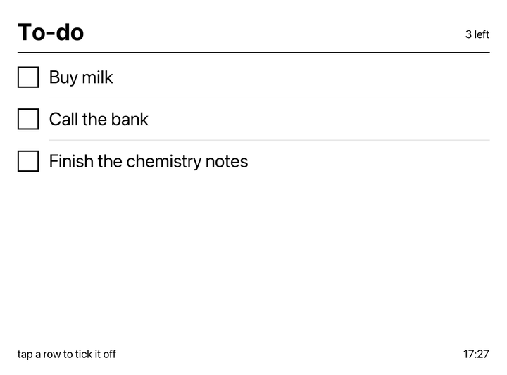

| Command | What it does |
|---|---|
| `kindle todo` | Shows the to-do screen. Tap a row on the Kindle to tick/untick it |
| `kindle todo add "Buy milk"` | Adds a to-do (the screen updates if it's showing) |
| `kindle todo remove "Buy milk"` / `kindle todo remove 2` | Removes by exact text (any case) or number. A wrong name prints "does not exist" and suggests the closest ones |
| `kindle todo done "Buy milk"` | Ticks/unticks from the Mac |
| `kindle todo clear` | Removes every ticked to-do |
| `kindle todo list` | Prints the list |

Taps are read by `touch.py` on the Pi. It ssh's into the Kindle and streams the touchscreen's
raw events (`cat /dev/input/eventN`), so nothing is installed on the Kindle. A tap redraws
the screen with a quick partial refresh (no flash). Install it once:
```sh
sudo cp ~/kindle-dash/kindle-touch.service /etc/systemd/system/
sudo systemctl daemon-reload
sudo systemctl enable --now kindle-touch.service
journalctl -u kindle-touch.service -f        # shows "touchscreen: /dev/input/eventN (...)"
```

**Kiosk mode.** The Kindle's own UI also sees your taps, so a tap could open a book under the
to-do screen. `kindle kiosk on` stops the Kindle UI (and redraws the dashboard);
`kindle kiosk off` starts it again so you can read. Holding power ~40 s also restarts it.

**If taps land in the wrong row**, stop the service and run the listener by hand with debug output:
```sh
sudo systemctl stop kindle-touch.service
~/kindle-dash/venv/bin/python ~/kindle-dash/touch.py --debug     # tap the 4 corners, Ctrl+C
sudo systemctl start kindle-touch.service
```
Each tap logs its raw, panel and canvas position. Then set `TOUCH_MAX_X/Y` (if raw values go
beyond 1072×1448), `TOUCH_SWAP_XY` or `TOUCH_FLIP_X/Y` at the top of `touch.py`. If no
touchscreen is found, set `TOUCH_DEVICE` (see `cat /proc/bus/input/devices` on the Kindle).

## Settings (top of `render.py`)

| Setting | What it does |
|---|---|
| `LOCATION = "London"` | Any place wttr.in understands. Put your own in `local_settings.py` (next to `render.py`, e.g. `LOCATION = "Paris"`): it's not in git, so your city stays private, and it replaces any setting here |
| `ROTATE = True`, `ROTATE_DEGREES = 90` | Draw landscape, then rotate. Use `270` if the image is upside down on your stand |
| `WTTR_NARROW = True` + `ROTATE = False` | Noon/night only, upright, ~50% bigger text (27px vs 18px) |
| `REFRESH_MINUTES = 1` | How often the Kindle is updated. After changing it, regenerate the timer (see below) |
| `WEATHER_CACHE_MINUTES = 15` | How often wttr.in is actually asked. It rate-limits, and its data changes hourly |
| `FULL_REFRESH_EVERY = 10` | Full black/white clear every N pushes (clears ghosting). The others are flash-free partial updates |
| `PHOTO_REFRESHES = 3` | Full black/white refreshes when a photo goes up (clears ghosting). `1` = a single flash |
| `PREVENT_SLEEP = True` | Stops the Kindle sleeping/showing the screensaver. Applied on every push |
| `DISPLAY_TOOL = "eips"` | Use `"fbink"` if `eips -g` doesn't show the PNG properly |

Test a change without the Kindle (the Pi has no screen, so preview it on the Mac):
```sh
ssh arham@arham-pi '~/kindle-dash/venv/bin/python ~/kindle-dash/render.py'   # on the Mac
scp arham@arham-pi:kindle-dash/out/weather.png /tmp/ && open /tmp/weather.png
```

If you change `REFRESH_MINUTES`:
```sh
cd ~/kindle-dash
venv/bin/python render.py --timer > dashboard.timer
sudo cp dashboard.timer /etc/systemd/system/
sudo systemctl daemon-reload && sudo systemctl restart dashboard.timer
```

## Install the timer

```sh
sudo cp ~/kindle-dash/dashboard.service ~/kindle-dash/dashboard.timer /etc/systemd/system/
sudo systemctl daemon-reload
sudo systemctl enable --now dashboard.timer
```

| Command | What it does |
|---|---|
| `systemctl list-timers dashboard.timer` | Shows when it runs next |
| `sudo systemctl start dashboard.service` | Runs once now |
| `journalctl -u dashboard.service -f` | Follows the logs |
| `journalctl -u dashboard.service --since today` | Shows today's logs |

## Kindle-side setup (you run these)

As of 2 Oct 2026 the Kindle is on firmware 5.16.2.1.1 and jailbroken (WinterBreak2,
`jb.sh v1.3.7`). It is **soft-float** firmware: hard-float ("HF") starts at 5.16.3.
That decides which packages work:

| Package | Use it? |
|---|---|
| Classic USBNetwork 0.22.N (`…install_pw2_and_up.bin`) | **Yes.** Its binaries use `/lib/ld-linux.so.3` (soft-float) |
| USBNetLite (`…_khf.bin`, from fw.notmarek.com) | **No.** Its binaries are hard-float and won't run on 5.16.2.1.1 |
| Hotfix from fw.notmarek.com/khf | **No.** That page says it's for HF firmware only |
| KindleModding Universal Hotfix 2.5.0 | **Yes.** It ships both armel and armhf and picks the right set |

All the right files are downloaded and laid out like the Kindle's drive in
`~/kindle-dash/kindle-files/to-copy/` (22 MB). The original downloads are in
`kindle-files/downloads/`.

**0. Keep Airplane mode ON.** `fill_disk/` (the anti-update filler) was removed on 2 Oct 2026,
leaving 2.8 GB free. If Wi-Fi comes on now, the Kindle can download a firmware update that
removes the jailbreak. For a permanent block, install `renameotabin` from KUAL later (linked from
fw.notmarek.com/khf; check it supports 5.16.2.1.1 first), or put a few hundred MB of filler back.

**1. Copy the staged files and add the Pi's SSH key.** If `/media/arham/Kindle` doesn't exist
(no desktop session to auto-mount it), mount it first with `udisksctl mount -b /dev/sda1`.
```sh
rsync -rv ~/kindle-dash/kindle-files/to-copy/ /media/arham/Kindle/
mkdir -p /media/arham/Kindle/usbnet/etc
cp ~/.ssh/kindle_ed25519.pub /media/arham/Kindle/usbnet/etc/authorized_keys
sync && udisksctl unmount -b /dev/sda1
```
USBNetwork's installer doesn't overwrite `usbnet/etc/authorized_keys`, so you can copy the
key before installing.

**2. Install the hotfix.** Unplug the Kindle. Go to Settings → ⋮ → Update Your Kindle and
wait for it to reboot. "Run Hotfix" then appears in the library. Tap it once.

**3. Install KUAL (PEKI).** Tap "KUAL" in the library. The first run installs KUAL and
opens it.

**4. Install USBNetwork.** In KUAL, open Helper → Install MR Packages. This needs MRPI, which
is in `extensions/MRInstaller`. The older `;log mrpi` search-bar command also works. The
Kindle reboots when it's done.

**5. Turn USBNetwork on.** Unplug the Kindle first: the toggle refuses to switch while it's
plugged in. Then open KUAL → USBNetwork → Toggle USBNetwork, and plug it into the Pi. The
same menu has an option to turn USBNetwork on automatically at boot, so it survives a
restart. The default config already has `KINDLE_IP=192.168.15.244` and `USE_WIFI="false"`.
While USBNetwork is on, the Kindle stops appearing as a USB drive. Toggle it off to copy
files again.

**6. On the Pi:** run `~/kindle-dash/setup_usbnet.sh`, review the nmcli command it prints,
and run it.

**7. Test:**
```sh
ping -c 3 192.168.15.244
ssh -i ~/.ssh/kindle_ed25519 root@192.168.15.244     # then: eips -c; eips -g /mnt/us/dashboard/screen.png
~/kindle-dash/push.sh
```

## Keep the Kindle UI from drawing over the image

pascalw/kindle-dash stops the reader UI and the screensaver. On the Kindle (over ssh):
```sh
lipc-set-prop com.lab126.powerd preventScreenSaver 1   # no sleep (push.sh already does this)
stop lab126_gui              # 5.16 firmware (upstart); kindle-dash uses /etc/init.d/framework stop
initctl stop webreader 2>/dev/null
```
Undo with `start lab126_gui` or a reboot (hold power ~40 s). None of this survives a
reboot. If you want it permanent, add it to `push.sh` before the display command.

## Troubleshooting

**Can't ping 192.168.15.244**
- `ip -br link` should show `usb0` or `enx…`. If not, USBNetwork is off or the Kindle is
  still in USB drive mode (it shows up in `lsblk`).
- `nmcli con show kindle-usb` and `ip -br addr` should show 192.168.15.201/24 on that
  interface. If the `enx…` name changed, see the `match.interface-name` tip that
  `setup_usbnet.sh` prints.

**ssh fails**
- Run `ssh -v -i ~/.ssh/kindle_ed25519 root@192.168.15.244` to see why.
- "Permission denied": the key isn't in `usbnet/etc/authorized_keys`, or that file isn't
  exactly the `.pub` line.
- Old dropbear without ed25519 support:
  `ssh-keygen -t rsa -b 4096 -N "" -f ~/.ssh/kindle_rsa`, use that `.pub` instead, and set
  `SSH_KEY = "~/.ssh/kindle_rsa"`.
- "Host key changed" after reinstalling USBNetwork: `rm ~/.ssh/known_hosts_kindle`.

**Image shows but is sideways or upside down**
- Change `ROTATE_DEGREES` between 90 and 270, run `render.py`, then `push.sh`.

**Image is skewed, striped, or blank**
- Set `DISPLAY_TOOL = "fbink"`. It uses the FBInk binary the hotfix installed at
  `/mnt/us/libkh/bin/fbink`.

**Screen goes back to the Kindle UI**
- See "Keep the Kindle UI from drawing over the image" above.
